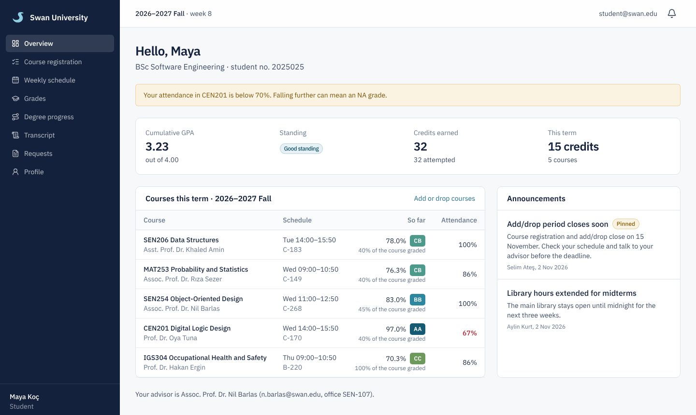
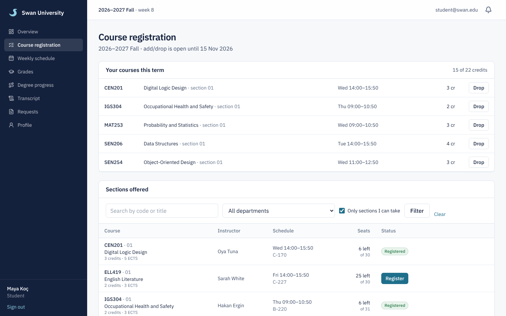
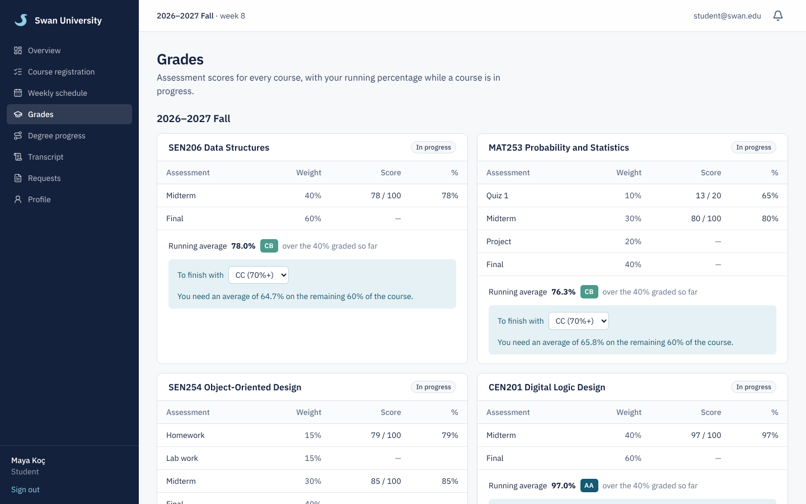
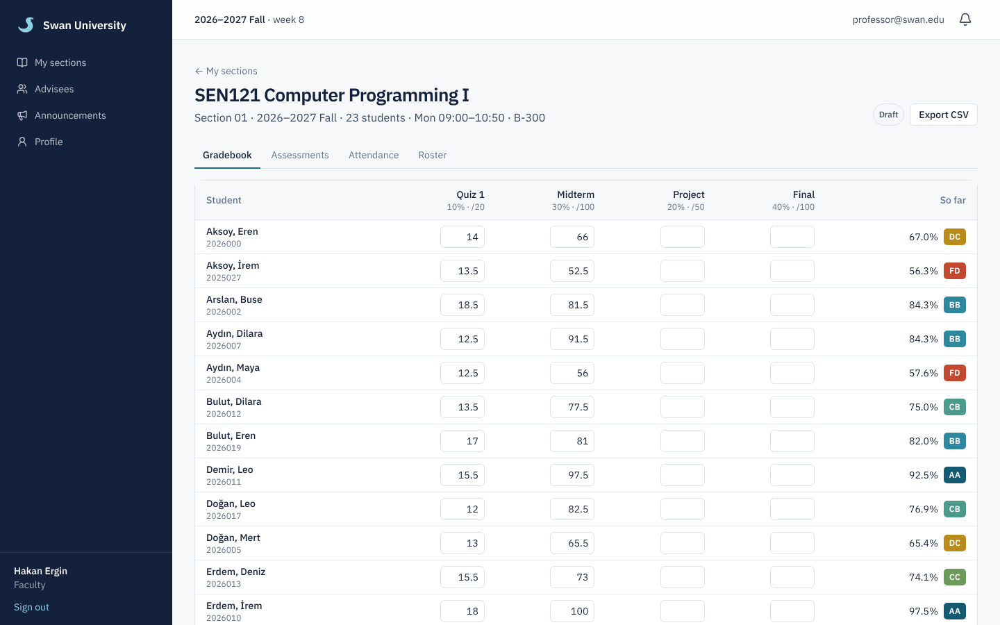
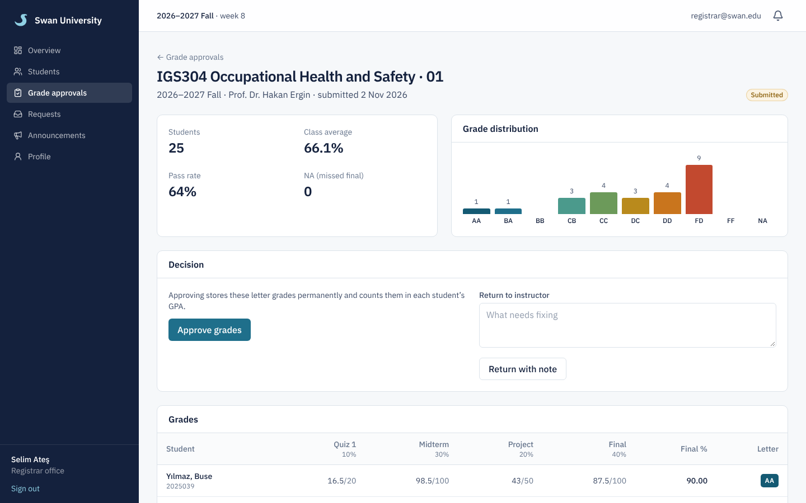
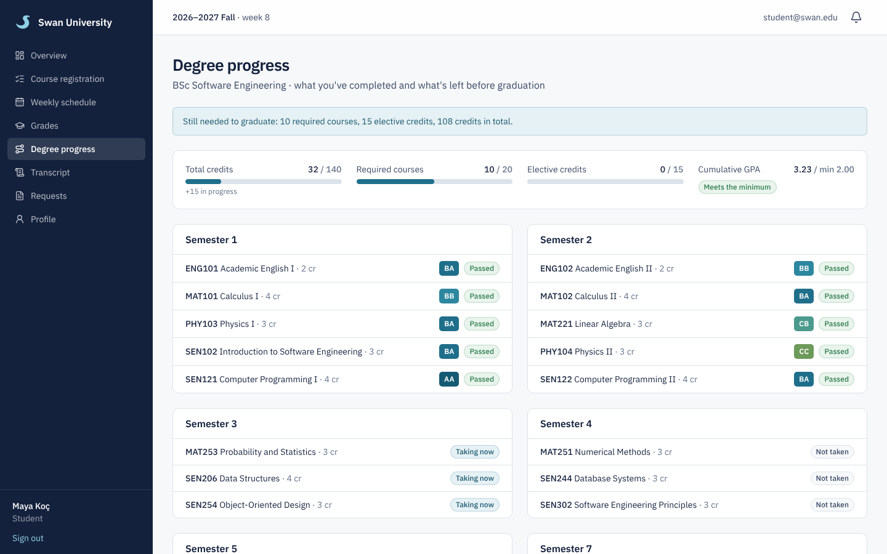
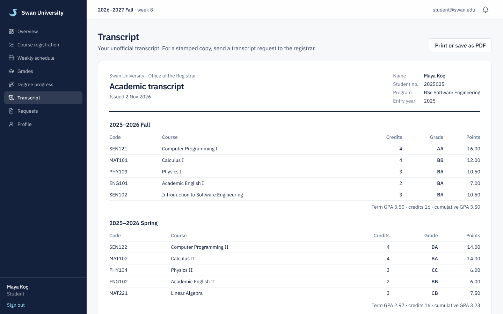
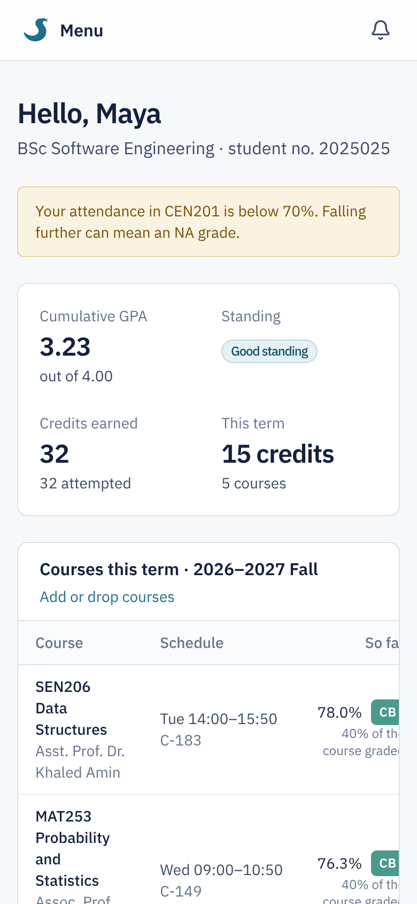

# Swan University

A student information system for a (fictional) university: course registration, weighted grading on the Turkish AA–FF scale, grade approval, transcripts, degree audits, attendance and notifications, with separate portals for students, professors, the registrar office and administrators.



This started as a PHP/MySQL project I built for a university course. I rebuilt it from scratch in TypeScript to fix the grading logic, close the security gaps and grow it into something closer to what a real registrar office uses. The [rebuild notes](#what-changed-from-the-php-version) list what was wrong with the original and how it's handled now.

## What each role can do

**Students**
- See their GPA, academic standing, credits and current courses with running grades and attendance
- Register for courses, with checks for prerequisites, seat limits, timetable clashes, credit limits, holds and the add/drop window
- See every assessment score, plus a planner that works out what they need on the rest of a course to reach a target grade
- Track degree progress against their program's curriculum
- Print an unofficial transcript, view a weekly timetable, and send requests (certificates, transcripts, grade appeals) to the registrar

**Professors**
- Run a gradebook per section: define weighted assessments, enter scores and watch percentages and letters update as they type
- Take attendance and see who is below the 70% limit
- Submit final grades for registrar approval, post section announcements, export a gradebook to CSV
- See their advisees, sorted so the students who need attention come first

**Registrar office**
- Review submitted grades with the class average, pass rate and grade distribution, then approve them or send them back with a note
- Manage student records, place and release holds, withdraw students from courses (W grade), print official transcripts
- Answer student requests and post announcements

**Administrators**
- Manage staff accounts, faculties, departments, programs and their curricula, courses and prerequisites, terms and sections
- Edit the grade scale and university settings
- Read the audit log, which records every change to grades, records, holds and settings

## Screenshots

| | |
|---|---|
|  |  |
| Course registration explains exactly why a section is blocked | Assessment scores, running average and the target planner |
|  |  |
| Professor gradebook with live results | Registrar reviewing a section before approving it |
|  |  |
| Degree audit against the program curriculum | Printable transcript |

<p align="center"></p>

## How grading works

Each section defines its own assessments (quizzes, homework, labs, projects, a midterm and a final), each with a weight and a maximum score. The weights must add up to exactly 100% before grades can be submitted.

- A student's course result is the weighted percentage: `Σ (score / max) × weight`.
- While a course is in progress, the running percentage only covers what has been graded so far.
- At submission, missing coursework counts as zero. A missing final exam gives **NA** instead, and the professor has to confirm that explicitly.
- Grades only count towards the GPA once the registrar approves them. At that point they're stored and locked.

Default scale (editable by admins):

| Letter | From | Points | | Letter | From | Points |
|---|---|---|---|---|---|---|
| AA | 90% | 4.0 | | DC | 65% | 1.5 |
| BA | 85% | 3.5 | | DD | 60% | 1.0 |
| BB | 80% | 3.0 | | FD | 50% | 0.5 |
| CB | 75% | 2.5 | | FF | 0% | 0.0 |
| CC | 70% | 2.0 | | NA | did not sit the final | 0.0 |

GPA and CGPA are credit-weighted. W (withdrawn) isn't counted. A retaken course counts once in the CGPA, using the latest attempt. DC and DD are conditional passes, so they can be retaken to raise the grade. Below a 2.00 CGPA a student is on academic probation, and a term GPA of 3.00 or 3.50 with no failed course earns honor or high honor.

## Tech stack

- **Next.js 16** (App Router, React Server Components, Server Actions) and **TypeScript**
- **PostgreSQL** with **Drizzle ORM** and versioned SQL migrations
- **Tailwind CSS 4**, IBM Plex Sans, lucide icons
- **Zod** for validation, **jose** for signed session cookies, **bcrypt** for passwords
- **Vitest** for unit tests, **Playwright** for end-to-end tests
- **Docker Compose** for a one-command setup, **GitHub Actions** for CI

### Project layout

```
src/
  domain/      Pure business rules: grading, GPA, registration checks, degree audit (unit tested)
  db/          Schema, migrations runner and demo data seed
  server/      Data access and server actions, grouped by role
  lib/         Auth, sessions, audit logging, email, CSV, helpers
  components/  Shared UI
  app/         Routes: /student, /professor, /registrar, /admin, plus the public site and login
  proxy.ts     Keeps each role inside its own area
e2e/           Browser tests for the main flows
drizzle/       SQL migrations
```

The grading, GPA, registration and degree audit rules live in `src/domain` as plain functions with no database access. Pages and actions load data, call those functions and save the results. This makes the rules easy to test and keeps the numbers identical everywhere they appear.

### Security

- Passwords hashed with bcrypt. Sessions are signed, HTTP-only cookies that are re-checked against the database on every request, so deactivating an account or changing a password signs the user out everywhere.
- Role checks at two layers: `proxy.ts` for routing, and inside every page and server action. Professors can only open their own sections, and advisors only their own advisees.
- Login rate limiting (5 failed attempts per 15 minutes) and identical errors for unknown emails and wrong passwords.
- Server actions are protected against cross-site requests by Next.js; all input is validated with Zod; React escapes all output.
- Seat checks lock the section row, so two students can't take the last seat at the same time.
- CSV exports guard against spreadsheet formula injection.
- Everything sensitive is written to the audit log.

## Running it

### With Docker

```bash
docker compose up --build
```

Open http://localhost:3000. The first start applies migrations and loads the demo data.

### Locally

Requires Node.js 22 and PostgreSQL 16.

```bash
cp .env.example .env          # set DATABASE_URL and SESSION_SECRET
npm install
npm run db:migrate
npm run db:seed
npm run dev
```

### Demo accounts

Every account uses the password `swan-demo`. The login page has one-click buttons for these:

| Role | Email |
|---|---|
| Student | student@swan.edu |
| Professor | professor@swan.edu |
| Registrar | registrar@swan.edu |
| Admin | admin@swan.edu |

The seed creates 60 students across five terms of history, with grades, attendance, requests and a section waiting for grade approval. All names and data are made up, and dates are generated relative to today, so the current term is always in progress.

### Tests

```bash
npm test            # unit tests for the domain rules
npm run test:e2e    # browser tests; reseeds the database first
npm run lint && npm run typecheck
```

CI runs all of these on every push against a real PostgreSQL service.

## What changed from the PHP version

The original worked for demos but had real problems:

- **Grades were calculated from raw points, not percentages.** A student who scored 45/50 got a D instead of an A. A score of exactly 39 got no letter at all because of a gap in the scale. Zero scores couldn't be saved because 0 was treated as "empty".
- **"Grade" meant three things:** year level, a lookup table of year levels, and letter grades. Scores were stored as a single comma-separated string, so they couldn't be queried.
- **Security:** error messages from the URL were printed straight into pages (reflected XSS), deletes ran on plain links, the database password was in the code, and professors could post scores for any student.
- **Duplication:** the same data functions were copied into every role's folder, four times in some cases.

The rebuild replaces all of it: a normalised schema with one row per score, weighted assessments, a configurable grade scale, an approval workflow, and the security model described above. Each of the old grading bugs has a regression test.

## Roadmap

- **Analytics:** grade distributions over time, pass rates by course, and early warnings for at-risk students
- **Fees and invoicing:** tuition per credit, invoices and payments, with finance holds that block registration
- **AI assistant:** a support chatbot that answers questions about your own record and deadlines, plus a notes assistant that turns uploaded notes into summaries, flashcards and quizzes

## License

MIT
